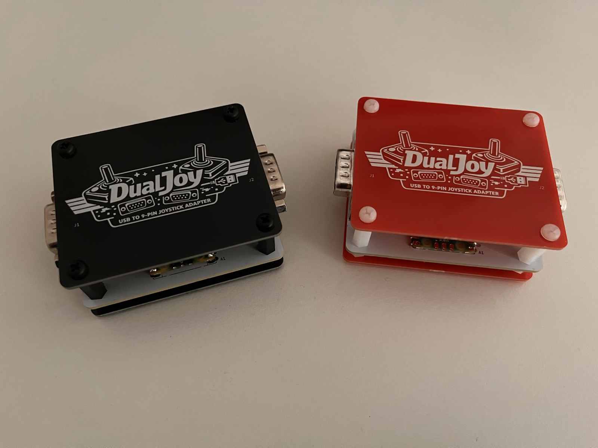
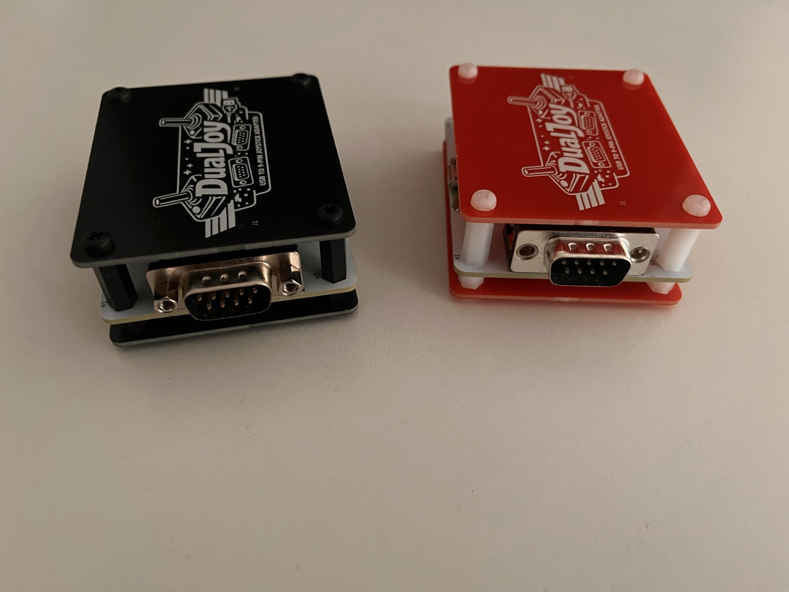
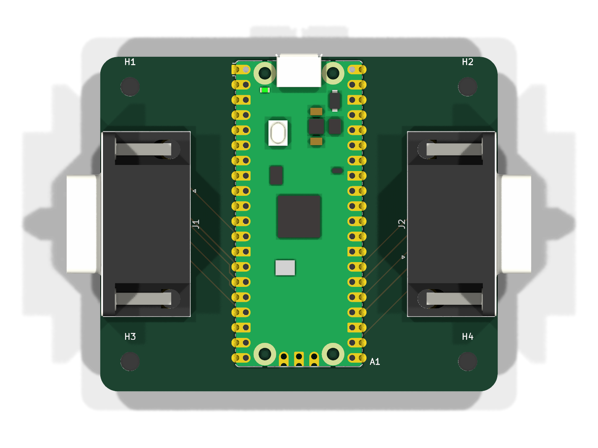
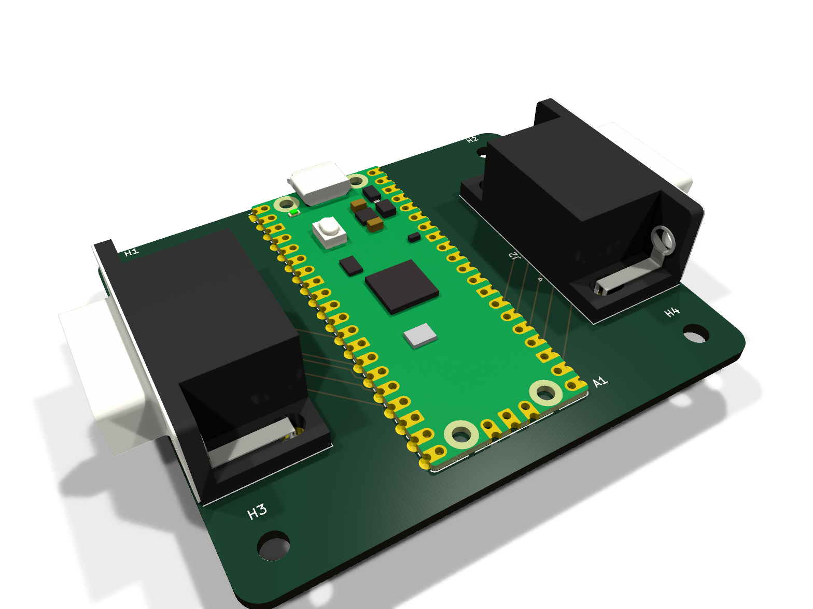
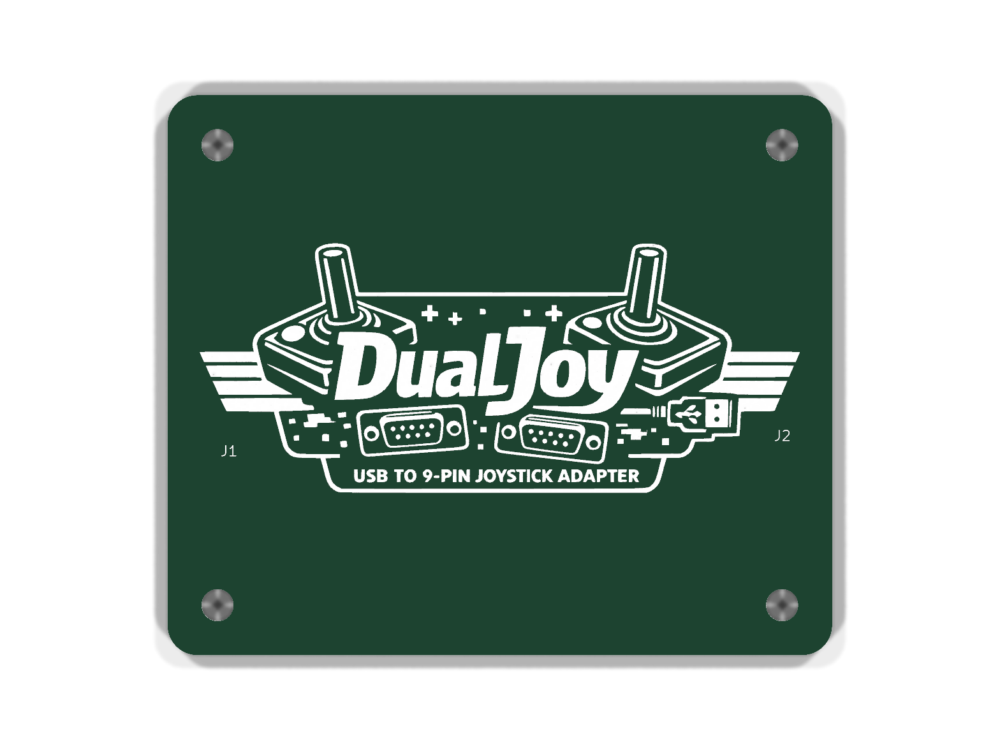
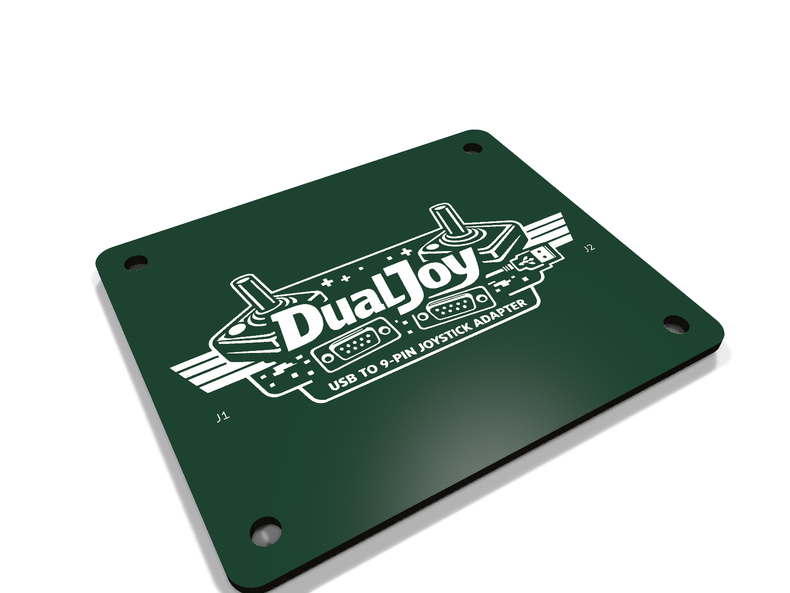
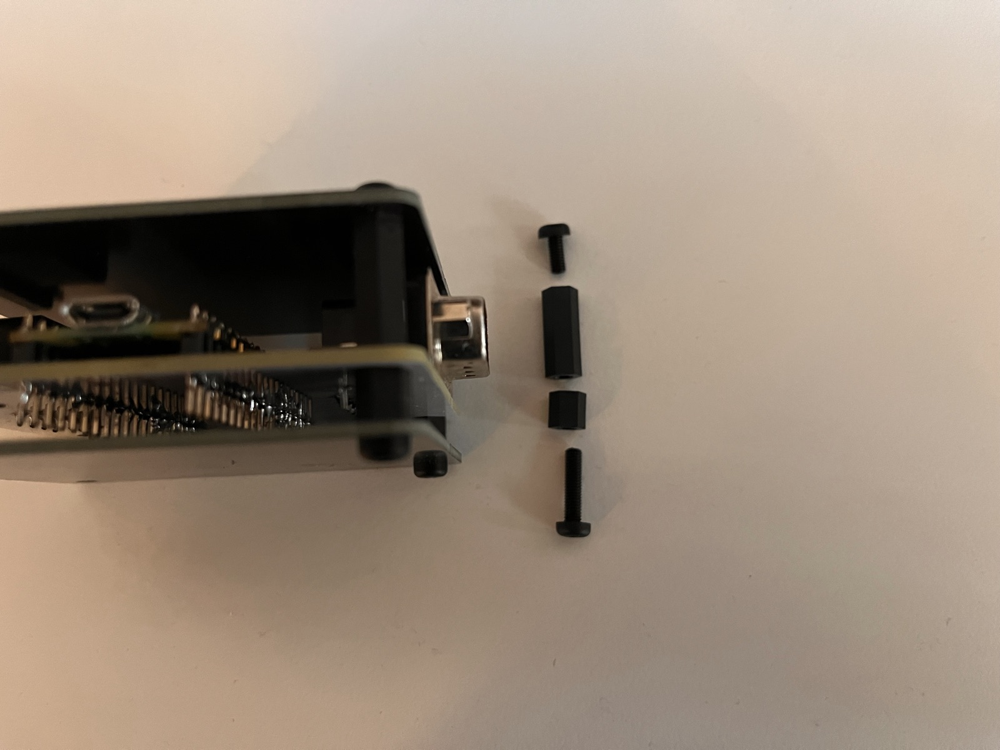
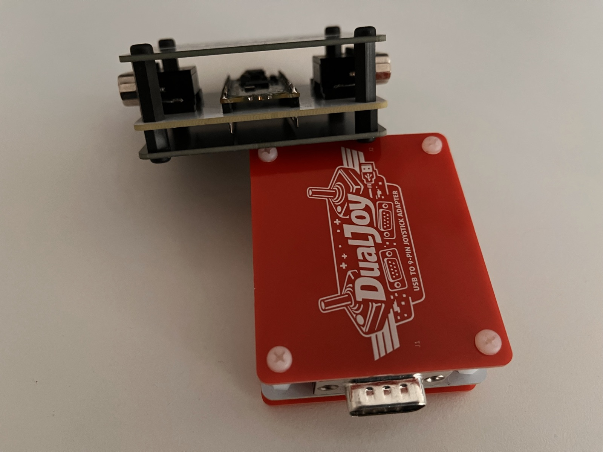

# DualJoy PCB

A PCB for the DualJoy firmware: a Raspberry Pi Pico and two D-SUB 9
connectors on one board, sandwiched between a top and a bottom plate that act
as a simple enclosure. The top plate carries the DualJoy logo in silkscreen.

  
  

The design consists of three boards:

Board | Description
:-|:-
Main board | Pico and the two D-SUB connectors
Top plate | Cover with the DualJoy logo
Bottom plate | Plain cover

Renders of the main board:

  
  

Renders of the top plate:

  
  

## Wiring

The main board uses the same GPIOs as the [firmware](../README.md#usage), so
the precompiled binary works without changes:

GPIO | D-SUB pin | Function
-:|:-|:-
10 | 1 (J1) | J1 UP
11 | 2 (J1) | J1 DOWN
12 | 3 (J1) | J1 LEFT
13 | 4 (J1) | J1 RIGHT
9 | 6 (J1) | J1 BTN
18 | 1 (J2) | J2 UP
19 | 2 (J2) | J2 DOWN
20 | 3 (J2) | J2 LEFT
21 | 4 (J2) | J2 RIGHT
17 | 6 (J2) | J2 BTN
GND | 8 (J1, J2) | GND

The schematic is available as [PDF](docs/dualjoy.pdf).

## Files

Path | Content
:-|:-
[`kicad/`](kicad/) | KiCad projects for all three boards (requires KiCad 10 or newer)
[`gerbers/`](gerbers/) | Gerber and drill files, one zip per board, ready to upload to a PCB fab
[`docs/`](docs/) | Schematic as PDF
[`images/`](images/) | Photos and renders

## Ordering

The boards were made by [JLCPCB](https://jlcpcb.com/). Upload each zip from
[`gerbers/`](gerbers/) as a separate order. Apart from the colour, the
standard options are fine: FR-4, 2 layers, 1.6 mm, 1 oz copper, HASL. All
three boards measure 66.45 × 55.98 mm.

Optionally choose "Remove Mark" under "Mark on PCB", so JLCPCB doesn't print
its order number on the board.

Board | Gerber file | Colour used
:-|:-|:-
Main board | `dualjoy-pcb-v1.0.zip` | white, black silkscreen
Top plate | `dualjoy-top-plate-v1.0.zip` | black or red, white silkscreen
Bottom plate | `dualjoy-bottom-plate-v1.0.zip` | black or red, white silkscreen

## Bill of materials

Qty | Part | Note
-:|:-|:-
1 | Raspberry Pi Pico or Pico 2 | soldered directly or with pin headers
2 | D-SUB 9 male connector, right angle, PCB mount | J1, J2, see below
4 | M3 × 15 mm standoff, female–female | between top plate and main board
4 | M3 × 6 mm standoff, female–female | between main board and bottom plate
4 | M3 × 6 mm screw | through the top plate
4 | M3 × 12 mm screw | through the bottom plate and main board

Any right-angle D-SUB 9 male connector with the standard PCB layout fits:
pitch 2.77 × 2.84 mm and two mounting holes 25 mm apart, centered between the
pin rows. These two have been used, both with a 9.4 mm footprint:

- [D-SUB ST 09EU](https://www.reichelt.de/de/de/shop/produkt/d-sub-stecker_9-polig_gewinkelt_rm_9_4-6986)
  (Reichelt), with 4-40 UNC screw locks fitted
- [W+P 107-09-1-1-0](https://www.reichelt.de/de/de/shop/produkt/d-sub_stecker_9-polig_gewinkelt-293990)
  (Reichelt), without screw locks

The standoffs and screws used are nylon, from an M3 assortment kit
([white](https://www.amazon.de/dp/B0DCS43SSC),
[black](https://www.amazon.de/dp/B09C21MS45)).

## Assembly

  
  

1. Solder the Pico and the two D-SUB connectors onto the main board. The Pico
   footprint supports both soldering the Pico directly onto the board and
   mounting it with pin headers soldered to the Pico first.
2. Flash the [DualJoy firmware](../README.md) onto the Pico.
3. Assemble the sandwich at each of the four corners, from top to bottom:
   - M3 × 6 mm screw through the top plate
   - M3 × 15 mm standoff
   - main board
   - M3 × 6 mm standoff
   - bottom plate, with the M3 × 12 mm screw from below through the bottom
     plate, the short standoff and the main board into the long standoff

The board has been built and tested with both the Raspberry Pi Pico and the
Pico 2, using the firmware from the main [README](../README.md#build).
